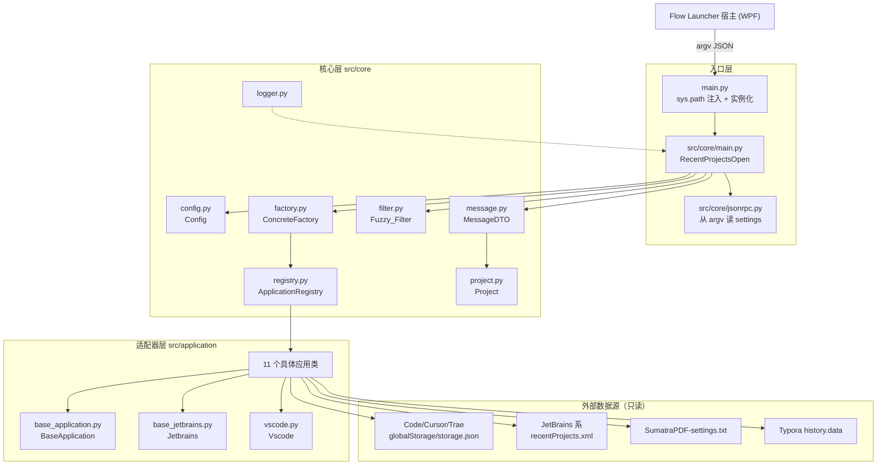
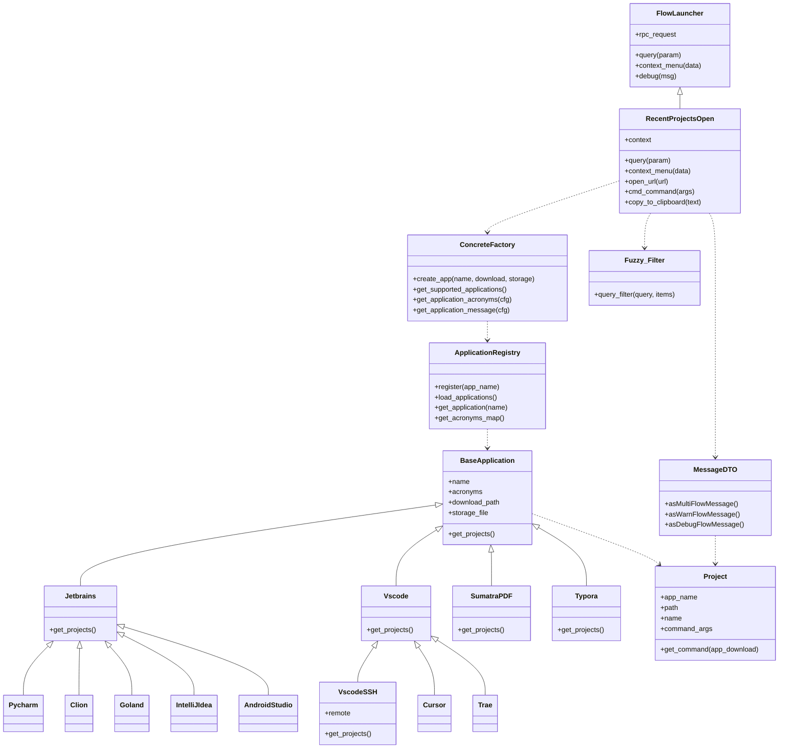

# RecentProjectsOpen 架构文档

> 项目：Flow.Launcher.Plugin.RecentProjectsOpen
> 插件版本：1.3.0（plugin.json）
> 文档基线：提交 4a873cc（main 分支）
> 插件类型：Flow Launcher **Python** 扩展，通过 JSON-RPC 与宿主通信
> 文档范围：代码结构、运行时模型、模块职责、数据链路、扩展方式、已知技术债

---

## 目录

1. [项目定位](#1-项目定位)
2. [技术栈与运行环境](#2-技术栈与运行环境)
3. [目录结构](#3-目录结构)
4. [运行时模型：一次性子进程 + JSON-RPC](#4-运行时模型一次性子进程--json-rpc)
5. [分层架构](#5-分层架构)
6. [核心模块详解](#6-核心模块详解)
7. [三种查询场景的完整链路](#7-三种查询场景的完整链路)
8. [应用适配层](#8-应用适配层)
9. [配置系统](#9-配置系统)
10. [消息契约（与宿主的 UI 接口）](#10-消息契约与宿主的-ui-接口)
11. [扩展指南：新增一个应用](#11-扩展指南新增一个应用)
12. [测试、格式化与 CI/CD](#12-测试格式化与-cicd)
13. [已知问题与技术债](#13-已知问题与技术债)
14. [附录：关键路径速查](#14-附录关键路径速查)

---

## 1. 项目定位

这是 [Flow Launcher](https://www.flowlauncher.com/)（Windows 上的启动器，类似 PowerToys Run）的第三方插件。
它的**唯一职责**是：读取各类 IDE / 编辑器 / 阅读器自己维护的「最近打开列表」文件，把它们变成 Flow Launcher 可搜索、可回车启动的条目。

支持 11 个目标程序：VSCODE、VSCODE_SSH、CURSOR、TRAE、PYCHARM、CLION、GOLAND、INTELLIJ_IDEA、ANDROID_STUDIO、SUMATRA、TYPORA。

---

## 2. 技术栈与运行环境

| 维度 | 选型 | 说明 |
| --- | --- | --- |
| 语言 | Python 3.9 – 3.13 | CI 矩阵 3.9/3.11/3.13；`src/core/jsonrpc.py` 对 <3.11 用 `typing_extensions` 兜底 |
| 宿主协议 | JSON-RPC over argv/stdout | 依赖 [`flowlauncher==0.2.0`](../requirements.txt) |
| 模糊匹配 | `difflib.SequenceMatcher`（标准库） | 前缀 / 子串 / 相似度 0.9，无第三方依赖 |
| 拼音 | `pypinyin` | 中文项目名支持拼音检索 |
| 配置 UI | `SettingsTemplate.yaml` | Flow Launcher Settings Panel 的 schema |
| 质量保障 | `ruff`（format+check）、`pre-commit`、`unittest` | 见 [.pre-commit-config.yaml](../.pre-commit-config.yaml) |
| 打包 | GitHub Actions（windows-latest）→ zip | 只装 `requirements.txt`（纯 Python），发布前跑产物冒烟测试 |

运行时目录约定的关键点：`main.py` 会把**项目根目录**、**根目录/lib**、**根目录/src** 三个路径塞进 `sys.path`，
所以代码里能写 `from src.core.main import ...`，同时线上 zip 包的第三方依赖在 `lib/` 下也能被 import。

> ⚠️ JSON-RPC 通道契约：Flow 的 `JsonRPCPlugin.ExecuteAsync` 把**任何非空 stderr** 视为失败
> （`case (_, not 0) => throw new InvalidDataException`），并丢弃已经产生的 stdout。
> 因此 `main.py` 入口会 `warnings.filterwarnings("ignore")` 并把 `sys.stderr` 重定向到
> `logs/stderr.log`；业务代码禁止 `print()`（会污染 stdout），只能使用 logger。

---

## 3. 目录结构

```
RecentProjectsOpen/
├── main.py                     # 进程入口：sys.path 注入 + 实例化插件类
├── plugin.json                 # Flow Launcher 插件清单（ID / 触发词 / 版本 / 入口 / 图标）
├── SettingsTemplate.yaml       # 设置面板 schema（4 个配置项）
├── requirements.txt            # 运行时依赖（纯 Python：flowlauncher / pypinyin / typing_extensions）
├── requirements-dev.txt        # 开发依赖（-r requirements.txt + ruff + pre-commit）
├── README.md                   # 安装、路径配置、用法、贡献指南
│
├── src/
│   ├── __init__.py
│   ├── core/                   # 与具体 IDE 无关的「内核」
│   │   ├── main.py             # ★ 插件主类 RecentProjectsOpen（继承 FlowLauncher）
│   │   ├── config.py           # 配置对象 Config(dict) 及模块级单例
│   │   ├── factory.py          # 抽象工厂 + 具体工厂（建实例、拼建议列表、算缩写表）
│   │   ├── registry.py         # 应用注册表（装饰器注册 + 动态 import 扫描）
│   │   ├── filter.py           # 检索策略：拼音前缀 / 子串 / SequenceMatcher 相似度
│   │   ├── message.py          # DTO：把领域对象翻译成宿主认识的 dict
│   │   ├── project.py          # 领域模型 Project（路径 + 启动命令参数）
│   │   ├── jsonrpc.py          # 最小 JSON-RPC 读取器（从 argv[1] 取 settings）
│   │   └── logger.py           # 按天滚动文件日志（只写文件，不碰 stderr）+ atexit 关闭
│   └── application/            # 适配器层：一个 IDE 一个文件
│       ├── base_application.py # 抽象基类 BaseApplication
│       ├── base_jetbrains.py   # JetBrains 系共享基类（解析 recentProjects.xml）
│       ├── vscode.py           # VS Code 系共享基类（解析 storage.json）
│       ├── vscode_ssh.py       # 远程/WSL 场景（继承 Vscode 并覆写）
│       ├── cursor.py / trae.py # 仅改 name/acronyms 的 Vscode 子类（各 10 行）
│       ├── pycharm.py / clion.py / goland.py / idea.py / android_studio.py
│       │                       # 仅改 name/acronyms 的 Jetbrains 子类
│       ├── sumatra.py          # 正则解析 SumatraPDF-settings.txt
│       └── typora.py           # hex→JSON 解析 history.data
│
├── icons/                      # 11 个程序图标 + app.png + warn.png
├── image/README/               # README 截图
├── test/                       # 7 个 unittest 模块 + mock_data/ 真实样本
│   └── mock_data/              # storage.json / recentProjects.xml / settings.txt / history.data
├── docs/                       # 本文档
├── .github/workflows/          # ci.yml（测试+lint）、Publish Release.yml（打 tag 发版）
└── .pre-commit-config.yaml     # ruff format + ruff check
```

**目录即架构**：`src/core` 放「平台无关逻辑」，`src/application` 放「平台差异」。新增一个 IDE 不应触碰 core。

---

## 4. 运行时模型：一次性子进程 + JSON-RPC

这是理解本项目最重要的一节。**插件不是常驻进程**。

### 4.1 进程生命周期

Flow Launcher（C#/WPF）每次需要结果时，都会**新起一个 Python 进程**，通过命令行参数把请求 JSON 传进去；
插件把结果 JSON 打到 stdout 后**进程退出**：

```
# 宿主实际执行的命令（简化）
python main.py '{"method":"query","parameters":["vsc proj"],"settings":{...}}'
```

`flowlauncher.FlowLauncher.__init__` 的固定套路（上游库实现）：

1. `json.loads(sys.argv[1])` 取出 `method` / `parameters`；
2. 用 `inspect.getmembers(self, ismethod)` 按名字找到方法并调用，例如 `query("vsc proj")`；
3. 若方法是 `query` 或 `context_menu`，把 `{"result": ..., "debugMessage": ...}` 打到 stdout。

### 4.2 协议格式

**请求**（宿主 → 插件，argv[1]）：

```json
{
  "method": "query",
  "parameters": ["vsc proj"],
  "settings": {
    "program_path": "VSCODE_DOWNLOAD=...\nVSCODE_STORAGE=...",
    "suggestions_list": "",
    "plugin_trigger_keyword": "r",
    "custom_acronyms_map": ""
  }
}
```

**响应**（插件 → 宿主，stdout 单行 JSON）：

```json
{
  "result": [
    {
      "Title": "proj",
      "SubTitle": "D:/Project/proj",
      "IcoPath": "icons/VSCODE.png",
      "ContextData": ["D:/VSCode/bin/code", "D:/Project/proj"],
      "jsonRPCAction": {
        "method": "cmd_command",
        "parameters": ["D:/VSCode/bin/code", "D:/Project/proj"]
      }
    }
  ],
  "debugMessage": ""
}
```

`jsonRPCAction.method` 有两种来源：

- **插件自身方法**：`cmd_command`（启动程序）、`copy_to_clipboard`、`open_url`；
- **宿主内置方法**：`Flow.Launcher.ChangeQuery`（把输入框内容替换成指定字符串，用于建议列表的「选中即补全」）。

---

## 5. 分层架构

### 5.1 整体分层



各层依赖方向**自上而下单向**：`core/main.py` 依赖 core 的其余模块与工厂；工厂依赖注册表；
注册表依赖 `application/*`；适配器只依赖 `Project` 与 `BaseApplication`。没有反向依赖。

### 5.2 复用到的设计模式

| 模式 | 落点 | 作用 |
| --- | --- | --- |
| 装饰器 + 注册表 | [`ApplicationRegistry.register`](../src/core/registry.py#L13) | 应用类声明即注册，`"VSCODE"` → 类 |
| 插件化的动态导入 | [`load_applications`](../src/core/registry.py#L25) | 扫 `application/*.py` 自动 import，新增文件无需改任何清单 |
| 抽象工厂 | [`AbstractFactory` / `ConcreteFactory`](../src/core/factory.py#L13) | 屏蔽「名字 → 实例」的构造细节 |
| 模板方法 | [`BaseApplication.get_projects`](../src/application/base_application.py#L25) | 定义 `get_projects()` 契约，子类实现解析逻辑 |
| 策略 | [`Filter` / `Fuzzy_Filter`](../src/core/filter.py#L19) | 检索算法可替换 |
| DTO | [`MessageDTO`](../src/core/message.py) | 领域对象 → 宿主的 JSON 结构，集中管理字段名 |

### 5.3 类图




## 6. 核心模块详解

### 6.1 [`src/core/main.py`](../src/core/main.py)：插件主类

`RecentProjectsOpen` 继承 `flowlauncher.FlowLauncher`。基类在构造时读取 `sys.argv[1]` 的 JSON，
按 `method` 反射调用同名方法，并把 `query` / `context_menu` 的返回值 `print` 到 **stdout**。
因此"stdout 只能是 JSON"这条契约由基类保证，业务代码只能追加日志、不能追加输出。

| 方法 | 职责 |
| --- | --- |
| `query(param)` | 解析 `acronym + query`，读配置、建应用实例、取项目、过滤，最后交给 `MessageDTO` |
| `context_menu(data)` | 校验 `ContextData`（`[exe, path]`）后返回"复制路径 / 资源管理器打开 / 仓库链接"三项 |
| `cmd_command(*args)` | `subprocess.Popen(args, shell=True)` 启动 IDE，stdout/stderr 均丢弃 |
| `copy_to_clipboard(text)` | `echo text \| clip`（技术债，见 13.2） |
| `open_url(url)` | `webbrowser.open` |

### 6.2 [`src/core/config.py`](../src/core/config.py)：配置单例

`Config(dict)` 在 import 时即解析一次宿主 settings，模块级单例 `config` 被全仓库共享。

- `program_path`：按行 `KEY=VALUE` 拆分，键名约定为 `<注册键>_DOWNLOAD` / `<注册键>_STORAGE`
- `suggestions_list`：按行转大写，为空时返回 `None`（触发"自动推断"分支）
- `custom_acronyms_map`：按行 `PROGRAM=acr` 解析成 `dict`
- 其余键原样透传（如 `plugin_trigger_keyword`）

### 6.3 [`src/core/registry.py`](../src/core/registry.py)：注册表

- 两个 `ClassVar` 字典：`_applications`（注册键 → 类）、`_acronyms_map`（缩写 → 注册键）
- `register(name)` 装饰器在 import 时执行，会临时 `application_class("", "")` 只为读取 `acronyms`
- `load_applications()` 扫描 `src/application/*.py` 动态 import，新增文件无需登记
- `_loaded` 标记设置了但从未读取（见 13.1-6）

### 6.4 [`src/core/factory.py`](../src/core/factory.py)：工厂 + 缩写 + 建议

`ConcreteFactory` 目前承担三件事（13.2 已标注职责过多）：

1. `create_app(name, download, storage)`：查注册表并实例化
2. `get_application_acronyms(config)`：默认缩写表与用户自定义合并，**用户自定义优先**；
   默认项只在缩写未被占用时补入
3. `get_application_message(config)`：生成空查询时的建议项，`score = (100 - idx) * 10000` 保序，
   点击后发 `Flow.Launcher.ChangeQuery` 把输入补全成 `r <acronym> `

### 6.5 [`src/core/filter.py`](../src/core/filter.py)：检索策略

`Filter` 是抽象策略，`Fuzzy_Filter` 是唯一实现：

```text
query --lazy_pinyin--> query_pinyin
项目名 --lazy_pinyin--> project_pinyin
命中条件 = startswith(query_pinyin)
        or query_pinyin in project_pinyin
        or SequenceMatcher(query_pinyin, project_pinyin).ratio() >= 0.9
```

- 空查询直接返回全量（交给调用方决定怎么展示）
- 使用标准库 `difflib`，无第三方依赖、无 stderr 警告
- 阈值 0.9 的取舍见 `FUZZY_THRESHOLD` 注释：容忍长名称单字符笔误，区分 `project1`/`project2`

### 6.6 [`src/core/message.py`](../src/core/message.py)：DTO

字段名与 Flow 的 `Result` 模型对齐（`Title` / `SubTitle` / `IcoPath` / `ContextData` / `jsonRPCAction`）。
三种形态：多结果（`asMultiFlowMessage`）、警告（`asWarnFlowMessage`，`icons/warn.png`）、调试（`asDebugFlowMessage`）。

### 6.7 [`src/core/project.py`](../src/core/project.py)：领域对象

`Project` 只保存 `app_name` / `path` / `name`（`os.path.basename`）/ `command_args`；
`get_command(download)` 产出启动参数：默认 `[download, path]`，有 `command_args` 时 `[download] + command_args`
（VSCode SSH 用这条路径拼 `--remote ssh-remote+host folder`）。

### 6.8 [`src/core/jsonrpc.py`](../src/core/jsonrpc.py)：协议适配

- `JsonRPCRequest`：`TypedDict(method, parameters, settings?)`，<3.11 用 `typing_extensions` 兜底
- `JsonRPCClient.recieve()` 从 `sys.argv[1]` 读请求，失败时降级为 `{"method": "query", "parameters": [""]}`
- `settings()` 返回请求里的 `settings` 字段，供 `Config` 使用

### 6.9 [`src/core/logger.py`](../src/core/logger.py)：日志

- 唯一的 `FileHandler`，按天写 `logs/chat_YYYY_MM_DD.log`，级别 DEBUG
- **不挂 `StreamHandler`**：stderr 是 JSON-RPC 的失败信号，日志绝不能写进去
- `atexit` 注册 `close_logger`，进程退出时释放句柄

---

## 7. 三种查询场景的完整链路

### 7.1 空查询：只输入触发词

```text
用户输入 "r"
  -> Flow 调用 query("")
  -> ConcreteFactory.get_application_message(config)
       suggestions_list 非空 -> 用它
       suggestions_list 为空 -> 用已配置 DOWNLOAD+STORAGE 的应用
  -> 每项 jsonRPCAction = Flow.Launcher.ChangeQuery("r <acronym> ", false)
```

### 7.2 带参数查询：列项目

```text
用户输入 "r idea ruo"
  -> query("idea ruo")
  -> acronyms = "idea" -> INTELLIJ_IDEA
  -> config: INTELLIJ_IDEA_DOWNLOAD / INTELLIJ_IDEA_STORAGE（缺任一 -> warn 项）
  -> ConcreteFactory.create_app -> IntelliJIdea.get_projects()
       ElementTree 解析 recentProjects.xml 的 entry@key
  -> Fuzzy_Filter.query_filter("ruo", projects)
  -> MessageDTO.asMultiFlowMessage(...)
```

任何一步抛 `NotImplementedError` / `FileNotFoundError` 都会转成 warn 项；
其他异常会冒泡成 Python traceback，被 `main.py` 的 stderr 重定向接住（用户侧表现为空结果，日志可查）。

### 7.3 执行结果：启动 IDE

```text
用户回车选中结果
  -> Flow 取 jsonRPCAction{method: "cmd_command", parameters: [exe, path]}
  -> 重新拉起 python main.py '{"method":"cmd_command",...}'
  -> subprocess.Popen([exe, path], shell=True, stdout=PIPE, stderr=PIPE)
  -> 本进程无任何 stdout 输出
  -> Flow 侧 switch(0, 0) -> 仅记录 "Empty JSON-RPC Response."，不报错
```

### 7.4 右键菜单

```text
用户对结果按右键
  -> Flow 发 context_menu，参数是结果的 ContextData（即 [exe, path] 数组）
  -> 正则 ^[A-Za-z]:/[\w\-/]+$ 校验
       命中 -> 复制路径 / 资源管理器打开 / 打开仓库
       未命中 -> 只返回"打开仓库"一项
```

---

## 8. 应用适配层

### 8.1 两个基类，覆盖 80% 的场景

| 基类 | 数据源 | 解析方式 | 派生类 |
| --- | --- | --- | --- |
| [`BaseApplication`](../src/application/base_application.py) | 无（抽象） | `get_projects()` 强制子类实现 | 直接派生：`SumatraPDF`、`Typora` |
| [`Vscode`](../src/application/vscode.py#L21) | `storage.json` | `json.load` → `profileAssociations.workspaces` 的 key | `Cursor`、`Trae`、`VscodeSSH` |
| [`Jetbrains`](../src/application/base_jetbrains.py#L16) | `recentProjects.xml` | `ElementTree` XPath 查 `entry@key` | `Pycharm`、`Clion`、`Goland`、`IntelliJIdea`、`AndroidStudio` |

派生类通常只有 10 行，只改 `name` 与 `acronyms`——这正是「目录即架构」的收益。

### 8.2 应用矩阵

| 应用名（注册键） | 类 | 缩写 | 图标 | 存储文件 |
| --- | --- | --- | --- | --- |
| `VSCODE` | `Vscode` | `vsc` | `icons/VSCODE.png` | `%APPDATA%/Code/User/globalStorage/storage.json` |
| `VSCODE_SSH` | `VscodeSSH` | `vscs` | `icons/VSCODE_SSH.png` | 同上（筛 `vscode-remote` / `wsl` 开头的 key） |
| `CURSOR` | `Cursor` | `cur` | `icons/CURSOR.png` | `%APPDATA%/Cursor/globalStorage/storage.json` |
| `TRAE` | `Trae` | `trae` | `icons/TRAE.png` | Trae 的 `storage.json` |
| `PYCHARM` | `Pycharm` | `py` | `icons/PYCHARM.png` | `%APPDATA%/JetBrains/PyCharm*/options/recentProjects.xml` |
| `CLION` | `Clion` | `cl` | `icons/CLION.png` | 同上（CLion*） |
| `GOLAND` | `Goland` | `go` | `icons/GOLAND.png` | 同上（GoLand*） |
| `INTELLIJ_IDEA` | `IntelliJIdea` | `idea` | `icons/INTELLIJ_IDEA.png` | 同上（IntelliJIdea*） |
| `ANDROID_STUDIO` | `AndroidStudio` | `as` | `icons/ANDROID_STUDIO.png` | `%APPDATA%/Google/AndroidStudio*/options/recentProjects.xml` |
| `SUMATRA` | `SumatraPDF` | `pdf` | `icons/SUMATRA.png` | `%APPDATA%/SumatraPDF/SumatraPDF-settings.txt` |
| `TYPORA` | `Typora` | `ty` | `icons/TYPORA.png` | `%APPDATA%/Typora/history.data` |

> 注意：注册键是 `SUMATRA`，缩写是 `pdf`；1.3.1 起 README 已同步（原文档误写 `SUMATRA_PDF`）。

## 9. 配置系统

`SettingsTemplate.yaml` 是**唯一**的配置声明源（宿主据此渲染设置面板），`Config` 是唯一的解析入口。
两者靠 `name` 字段对齐：

| 设置项 | 类型 | 默认 | 解析后形态 | 使用者 |
| --- | --- | --- | --- | --- |
| `program_path` | textarea | 空 | `{"VSCODE_DOWNLOAD": "...", "VSCODE_STORAGE": "..."}` | `query`、`get_application_message` |
| `suggestions_list` | textarea | 空 | `list[str]`（空则自动推断） | `get_application_message` |
| `plugin_trigger_keyword` | input | `r` | `str` | `get_application_message`（拼 `ChangeQuery`） |
| `custom_acronyms_map` | textarea | 空 | `dict[str, str]` | `get_application_acronyms` |

`program_path` 的键名约定是 `<注册键>_DOWNLOAD` / `<注册键>_STORAGE`，
**这层「约定」是字符串拼接实现的**（`app_name + "_DOWNLOAD"`），编译器无法校验——
新增应用时忘了文档里的键名约定，运行时只会得到一条 warn 或 `None`。

---

## 10. 消息契约（与宿主的 UI 接口）

| 生产者 | 方法 | 结构 |
| --- | --- | --- |
| 项目结果 | `asMultiFlowMessage` | `Title` / `SubTitle` / `IcoPath` / `ContextData` / `jsonRPCAction` |
| 错误提示 | `asWarnFlowMessage` | `Title` / `SubTitle` / `IcoPath=icons/warn.png` |
| 调试 | `asDebugFlowMessage` | `Title` / `SubTitle="Debug"` / `IcoPath=icons/app.png` |
| 应用建议 | `ConcreteFactory.get_application_message` | `title` / `subTitle` / `icoPath` / `jsonRPCAction(ChangeQuery)` / `score` |

`ContextData` 是**回传给 `context_menu` 的载荷**，本项目直接塞了完整的启动命令列表，
于是右键菜单无需再查一遍配置——一种「把状态挂在 UI 项上」的隐式传参方式。

---

## 11. 扩展指南：新增一个应用

以新增 `ZED` 为例（3 步，不动 core）：

**Step 1** 新建 `src/application/zed.py`：

```python
import json
from typing import List

from ..core.project import Project
from ..core.registry import ApplicationRegistry
from .base_application import BaseApplication


@ApplicationRegistry.register("ZED")          # ① 注册键 = 配置前缀 = 图标名
class Zed(BaseApplication):
    def __init__(self, download_path: str, storage_file: str):
        super().__init__(download_path, storage_file)
        self.name = "ZED"                      # ② 用于 icons/ZED.png
        self.acronyms = "zed"                  # ③ 触发缩写

    def get_projects(self) -> List[Project]:
        if not self.storage_file:
            raise FileNotFoundError("storage_file not found")
        with open(self.storage_file, encoding="utf8") as f:
            data = json.load(f)
        return [Project(self.name, p) for p in data.get("recent", [])]
```

**Step 2** 放图标 `icons/ZED.png`（缺失时不致命，只是图标空白）。

**Step 3** 在 README 与 `SettingsTemplate.yaml` 说明键名（`ZED_DOWNLOAD` / `ZED_STORAGE`），
补一个 `test/test_zed.py` 与 `test/mock_data/` 样本。

**不需要**修改 `registry.py`、`factory.py`、`main.py` —— 扫描是自动的。

新增一个「与既有程序共享存储格式」的应用更省事：像 `cursor.py` 那样继承 `Vscode`，只覆盖
`name` / `acronyms`（10 行）。若行为有差异，则覆写 `get_projects`。

---

## 12. 测试、格式化与 CI/CD

### 12.1 测试

8 个 `unittest` 模块，40 个用例，覆盖：配置解析、DTO、Project/Filter、JetBrains、VSCode、Sumatra、Typora，
以及新增的 filter 单测与 JSON-RPC 通道回归测试（stderr 必须为空、stdout 必须是 JSON）。

```bash
python -m unittest discover -s test -p "test_*.py"
```

- 全部用**真实样本文本**驱动（`test/mock_data/`），没有 mock 文件 IO —— 好处是能验证真实格式，
  代价是样本必须脱敏后长期维护。
- `test_config.py` 用 `@patch("src.core.config.settings")` 拦截宿主 settings，是唯一 mock 边界。
- 本地实测：CPython 3.9.13 / 3.11.1 / 3.13.5 下 40 个用例全部通过。

### 12.2 格式化

`ruff-format` + `ruff-check --fix --exit-non-zero-on-fix`，`pre-commit install` 后随 commit 自动执行。

### 12.3 CI/CD

| 工作流 | 触发 | 动作 |
| --- | --- | --- |
| [`ci.yml`](../.github/workflows/ci.yml) | push/PR 到 main | `windows-latest` × py3.9/3.11/3.13 跑单测；`ubuntu-latest` 跑 pre-commit |
| [`Publish Release.yml`](../.github/workflows/Publish%20Release.yml) | 推 `v*` tag 或手动 | Windows 构建 → 只装运行时依赖到 `lib/` → 打 zip → 3.9/3.11/3.13 冒烟 → 发 GitHub Release |

发版包内依赖在 `lib/`，正好对应 `main.py` 里 `sys.path.append(.../lib)` 的设计，
宿主下载解压即用（`lib/` 已被 `.gitignore` 忽略）。

---

## 13. 已知问题与技术债

### 13.1 已确认的实现缺陷

| # | 位置 | 问题 | 状态 |
| --- | --- | --- | --- |
| 1 | [`src/core/main.py`](../src/core/main.py) | `except UsageError` 是**死代码**：`Config.get` 不会抛 `UsageError`。配置缺失时得到 `None`，最终变成 `Popen([None, ...])` | 已修复（1.3.1：显式判空并返回提示） |
| 2 | [`src/application/vscode.py`](../src/application/vscode.py) | `folder_url.replace("%3A", ":").replace("/", "\\")` 的**返回值被丢弃** | 已修复（1.3.1：删除死代码） |
| 3 | [`src/core/filter.py`](../src/core/filter.py) | `process.extractOne(query_pinyin, project_name_pinyin)` 第二参是**字符串而非列表**，按字符迭代；且阈值 `> 90` 永不命中 | 已修复（1.3.1：改用 difflib，新增子串匹配与单测） |
| 4 | `vscode.py` / `vscode_ssh.py` | `profileAssociations.get("workspaces")` 假设父键存在；storage.json 缺该键时抛 `AttributeError` | 待修复 |
| 5 | README vs 代码 | README 缩写表写 `SUMATRA_PDF`，代码注册键为 `SUMATRA` | 已修复（1.3.1：README 改为 `SUMATRA`） |
| 6 | [`src/core/registry.py`](../src/core/registry.py) | `cls._loaded = True` 设置了但从未读取 | 待修复 |
| 7 | [`.pre-commit-config.yaml`](../.pre-commit-config.yaml) | `exclude: tests/`，但仓库目录叫 `test/` —— 排除规则从未命中 | 已修复（1.3.1：移除该配置） |
| 8 | `vscode.py` | `folder_url[0].upper()` 假设首字符一定是盘符；UNC / WSL 路径会得到错误结果 | 待修复 |

### 13.2 设计层面的不足

- **错误处理不统一**：JetBrains 抛 `FileNotFoundError`，Sumatra / Typora 内部吞异常返回 `[]`。
  同一个「文件不存在」场景，用户看到两种反馈（warn vs 空列表）。
- **无统一排序抽象**：Typora 显式按时间排序，VSCode 靠倒序遍历 JSON key，JetBrains 完全依赖 XML 顺序。
  「最近使用」的语义在不同适配器间并不一致。
- **`ConcreteFactory` 职责过多**：实例化 + 缩写合并 + UI 消息生成三合一，已偏离「工厂」本意，
  可拆成 `AcronymService` 与 `SuggestionService`。
- **字符串约定隐形**：`<NAME>_DOWNLOAD` / `<NAME>_STORAGE`、`icons/<NAME>.png` 都靠命名约定耦合，
  既无类型也无启动期校验；建议在 `BaseApplication` 上声明键名或在厂商类里加 `validate_config()` 自检。
- **`context_menu` 的路径判定用正则**：不如直接 `os.path.isabs` + 规范化，且带空格的中文路径会失效。
- **`copy_to_clipboard` 用 shell 管道**：`echo` 对引号、`&`、`|` 等字符不安全，应改为把文本写进 `clip` 的 stdin。
- **无类型检查基线**：有 `TypedDict` 但未接 mypy / pyright；`Config.get` 的 `-> str` 注解与实际返回不符。

---

## 14. 附录：关键路径速查

| 需求 | 起点 | 关键符号 |
| --- | --- | --- |
| 改查询入口 / 错误提示 | [`src/core/main.py`](../src/core/main.py) | `RecentProjectsOpen.query` |
| 改配置解析 | [`src/core/config.py`](../src/core/config.py) | `Config._parse_settings` |
| 改检索算法 | [`src/core/filter.py`](../src/core/filter.py) | `Fuzzy_Filter.query_filter`、`FUZZY_THRESHOLD` |
| 新增一个 IDE | `src/application/<name>.py` | `@ApplicationRegistry.register` + `get_projects` |
| 改结果字段 | [`src/core/message.py`](../src/core/message.py) | `MessageDTO.asMultiFlowMessage` |
| 改宿主协议 | [`src/core/jsonrpc.py`](../src/core/jsonrpc.py) | `settings`、`JsonRPCRequest` |
| 排查 stderr 污染 | `logs/stderr.log` | `main.py` 的重定向目标 |

常用命令：

```bash
# 单测（3.9 / 3.11 / 3.13 都应通过）
python -m unittest discover -s test -p "test_*.py"

# lint + 格式（与 CI 一致）
ruff check . && ruff format --check .

# 发布产物冒烟（解包 -> 跑 query -> 断言 stderr 为空）
python tools/smoke_test.py RecentProjectsOpen.zip --python python

# 本地模拟发布（Windows）
pip install -r requirements.txt -t ./lib
```
